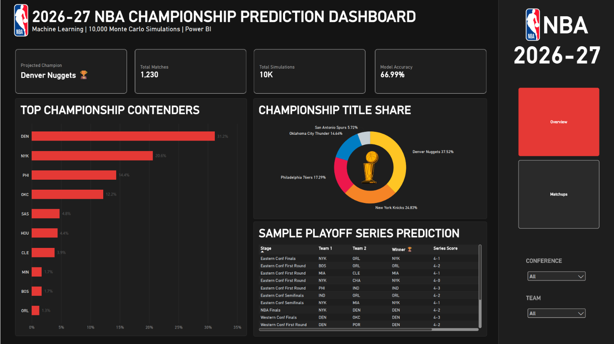
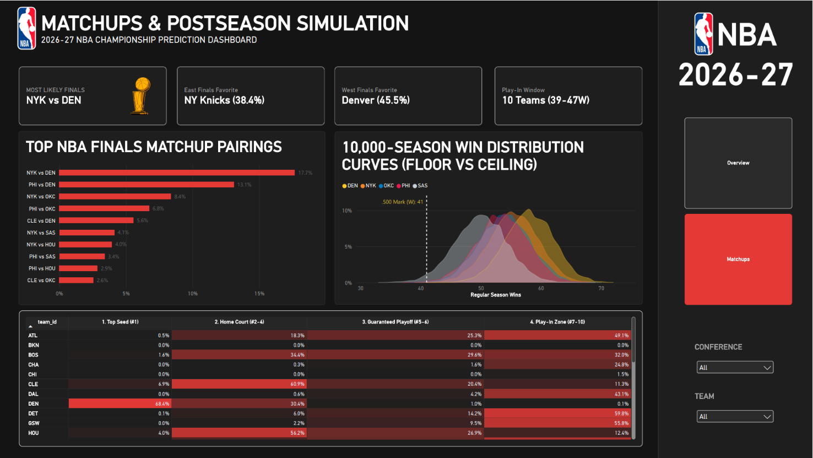

## Abstract

This project delivers an end-to-end sports analytics, machine learning, and simulation pipeline that forecasts the regular season standings, postseason seedings, and championship outcomes for the **2026-27 NBA season**. 

Rather than relying on raw box scores or subjective power rankings, this prediction engine is built on an exhaustive nine-layer feature engineering architecture that translates player-level telemetry, contextual fatigue, and team efficiency into causal win probabilities:

1. **Dean Oliver's Four Factors:** Quantifying the fundamental pillars of basketball efficiency for both offense and defense—Effective Field Goal Percentage (`eFG%`), Turnover Rate (`TOV%`), Offensive Rebounding Percentage (`OREB%`), and Free Throw Rate (`FTR`).
2. **Pace-Adjusted Advanced Ratings:** Normalizing scoring efficiency across differing game speeds to compute true Offensive Rating (`ORTG`), Defensive Rating (`DRTG`), and Net Rating (`NET_RATING = ORTG - DRTG`).
3. **Causal Rolling Pre-Game Form:** Calculating strictly backwards-looking 10-game rolling efficiency metrics and differential advantages (`DIFF_ROLL_NET_RATING`, `DIFF_ROLL_EFG`, etc.) knowable *prior* to tip-off, fully eliminating circular look-ahead data leakage.
4. **Contextual Schedule Fatigue & Rest:** Modeling rest days, back-to-back flags (`B2B`), and rest differentials (`REST_DIFF = Home Rest - Away Rest`) to capture physical fatigue.
5. **Bayesian VORP Shrinkage:** Applying empirical Bayes shrinkage ($K = 8.0$, replacement level $3.90$) across multi-season player Value Over Replacement Player (VORP) metrics to stabilize small-sample variance while preserving generational superstar impact.
6. **Rookie Draft-Slot Prior Imputation:** Solving the historical "rookie valuation dilemma" by calibrating historical draft-slot priors (Top-3 Picks: `6.60`, Lottery 4–14: `4.84`, Non-Lottery 1st Round: `2.80`, 2nd Round / Undrafted: `1.50`) so high-impact rookies are neither ignored nor artificially zeroed out.
7. **Rotation-Weighted Roster Aggregation:** Filtering each 15-man roster down to the core top-9 rotation players by minutes and value (`TOTAL_ROSTER_VALUE`), capturing the postseason reality that bench depth matters far less than playoff rotation strength.
8. **Playoff Experience & Resilience:** Quantifying roster-wide cumulative career playoff games played (`TOTAL_PLAYOFF_EXPERIENCE`) to capture crunch-time poise and championship battle-testing.
9. **Calibrated Modern Synergy Power Score:** Unifying team strength through a balanced 40/50/10 formula: 40% historical franchise rolling efficiency, 50% Bayesian active rotation value, and 10% playoff pedigree.

These engineered features train a well-calibrated machine learning win classifier, which feeds into a **10,000-season Monte Carlo simulation engine** simulating all 1,230 regular season games, the official NBA Play-In Tournament, and complete Best-of-7 playoff series to forecast the 2027 NBA Champion.

---

## Executive Summary & Final Verdict

Across 10,000 fully simulated seasons and playoffs, the **Denver Nuggets** emerge as the projected **2026-27 NBA Champion** with a **31.2% title probability**, anchored by the league's highest individual rotation valuation and Nikola Jokić's sustained peak. 

The **New York Knicks** lead the Eastern Conference with a **20.6% championship probability**, setting up **NYK vs. DEN (17.7%)** as the single most frequent simulated NBA Finals pairing.

### Top 10 Contender Projections

| Team | Conf | Projected Wins | Playoff Prob | Conf Finals Prob | Finals Prob | Championship Prob |
| :--- | :---: | :---: | :---: | :---: | :---: | :---: |
| **Denver Nuggets (DEN)** | West | **58.1** | 99.98% | 64.7% | 45.5% | **31.2%** |
| **New York Knicks (NYK)** | East | **55.4** | 99.91% | 58.3% | 38.4% | **20.6%** |
| **Philadelphia 76ers (PHI)** | East | **53.5** | 99.61% | 51.8% | 29.5% | **14.4%** |
| **Oklahoma City Thunder (OKC)**| West | **53.9** | 99.67% | 45.1% | 22.3% | **12.2%** |
| **San Antonio Spurs (SAS)** | West | **50.0** | 97.35% | 26.5% | 11.1% | **4.8%** |
| **Houston Rockets (HOU)** | West | **49.3** | 96.89% | 25.0% | 9.9% | **4.4%** |
| **Cleveland Cavaliers (CLE)** | East | **49.1** | 96.41% | 26.6% | 11.9% | **3.9%** |
| **Minnesota Timberwolves (MIN)**| West | **46.8** | 90.07% | 14.1% | 4.6% | **1.7%** |
| **Boston Celtics (BOS)** | East | **45.6** | 85.82% | 14.9% | 5.6% | **1.7%** |
| **Orlando Magic (ORL)** | East | **45.7** | 86.29% | 14.5% | 4.7% | **1.3%** |

---

## Power BI Executive Analytics Suite

The simulation telemetry and data model were compiled into a publication-grade, dark-themed Microsoft Power BI dashboard inspired by official NBA.com analytics portals.

### Page 1: Championship Overview & Title Shares

### Page 2: Matchups, Win Distributions & Postseason Seeds

---

## Acknowledgements & Data Sources

- **NBA Official Stats API (`stats.nba.com` via `nba_api`):** 2,460 regular season game logs (2024–25 and 2025–26 seasons) and complete postseason player box scores.
- **Basketball-Reference:** Historical playoff series outcomes, franchise win totals, and award voting data.
- **NBA Transactions & Opening Week Rosters (October 2026):** Active 15-man rosters, depth charts, age, experience, and trade movements.

---

## Tools & Tech Stack

- **Python (Pandas, NumPy, SciPy):** Ingestion, feature pipelines, rolling window efficiency calculations, and Monte Carlo engines.
- **Scikit-Learn & LightGBM:** Pre-game win classification, chronological time-series splitting, calibration curves, and ROC-AUC validation.
- **Power BI Desktop & DAX:** Star-schema dimensional modeling (`dim_teams`, `fact_team_projections`, `fact_finals_matchups`, `fact_win_distribution`, `fact_seed_distribution`), conditional formatting heatmaps, and executive KPI cards.
- **Quarto & GitHub Pages:** Reproducible technical publication, dark mode styling, and public web hosting.

---

## Predictive Modeling Results

To prevent look-ahead bias, game features were computed strictly from historical pre-game performance (rolling 10-game efficiency metrics, rest advantage, and Bayesian roster valuation). Models were evaluated on an out-of-sample chronological test set:

| Model | Accuracy | ROC-AUC | Engineering Notes |
| :--- | :---: | :---: | :--- |
| **Logistic Regression (Baseline)** | **66.99%** | **0.7324** | **Best calibrated model.** Avoided overfitting, aligned with true NBA home/away margins, and produced optimal probabilities for simulation. |
| **Random Forest Classifier** | 66.42% | 0.7251 | Strong non-linear interaction capture; slightly less calibrated on high-probability favorites. |
| **XGBoost Classifier** | 62.60% | 0.6731 | Tendency to overfit on noise in small rolling game windows without aggressive regularization. |

---

## Pipeline Architecture & Chapters

Explore the full methodology and code across the five project chapters:

1. [**01. Data Extraction & Integrity**](notebooks/01_data_extraction.ipynb): Raw box score ingestion, feature extraction, missing value auditing, and data sanity checks.
2. [**02. Feature Engineering & Valuation**](notebooks/02_feature_engineering.ipynb): Dean Oliver Four Factors, pace adjustments, Bayesian player shrinkage ($K=8.0$, replacement level $3.90$), and rookie draft-slot priors.
3. [**03. Machine Learning Win Models**](notebooks/03_model_training.ipynb): Rolling window causal features, chronological train/test splitting, ROC-AUC benchmarking, and feature importance analysis.
4. [**04. Monte Carlo Playoff Simulation**](notebooks/04_monte_carlo_sim.ipynb): 10,000 full-season simulations, tiebreakers, Play-In tournament brackets, and Best-of-7 series mechanics.
5. [**05. Conclusions & Reflections**](notebooks/05_conclusions_and_reflections.ipynb): Engineering post-mortems, look-ahead leakage traps, superstar weighting discoveries, and domain retrospectives.
